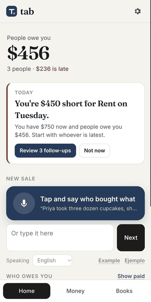

# Tab

**Get paid without the awkward part.**

Say a sale out loud. Tab sends a PayPal invoice in your customer's language, follows up politely when they're late, and warns you before you run short on rent.



*Recorded in practice mode (no PayPal or AI keys), using the typed example note. The mic fills in the same box.*

---

## Who it's for

One-person businesses that run on *"pay me Friday"*: home bakers, tutors, babysitters, cleaners, hair braiders. Many of them work in a second language. They don't need accounting software. They need someone to write it down and do the asking.

## What it does

| | |
|---|---|
| **Say it** | *"Priya took three dozen cupcakes, she'll pay Friday."* In any language. |
| **Confirm one sentence** | *"Invoice Priya $90 for 3 dozen cupcakes, due Friday"*, plus a preview of the note Priya will get, written in **her** language in **your** voice. |
| **Send with PayPal** | A real PayPal invoice with a Pay button, with a 5-second undo. It can also go out on WhatsApp. |
| **Know what's coming** | A 14-day cash outlook against your bills: *"You'll be $450 short for rent on Friday."* |
| **Follow up for you** | A daily plan: a gentle nudge, a firmer reminder, an offer to split the bill, or *leave them be, they were reminded today.* You approve, Tab sends. |
| **Cash counts too** | "Got paid in cash" records the payment on the PayPal invoice. |
| **Books** | Every invoice in one table: filter, search, export to CSV. |

The AI never moves money or sends a message on its own. It drafts and plans; you decide.

## Try it (3 minutes)

1. Open Tab. Tap **Example** (or the mic), then **Next**, then **Send with PayPal**.
2. Get paid: open the person → **their pay page** and pay with a PayPal sandbox buyer account, or tap **Got paid in cash**. The row turns green.
3. On Home, open the **Today** card → **Review follow-ups** → **Send**.

**Settings → Reset example data** restores the starting state.

## How it works

**PayPal** (Invoicing v2, Transaction Search, Webhooks)
- Create, send, remind, cancel, enable partial payments, and record cash payments on invoices.
- Live payment status through signature-verified webhooks, with polling as a fallback.
- Every write carries a `PayPal-Request-Id`, so retries never double-invoice.

**AI** (Google Gemini by default, Claude optional), always with schema-checked JSON output:
1. **Voice note → invoice:** matches the customer, resolves "Friday" to a date, and asks instead of guessing a price.
2. **Messages:** invoice notes and reminders in the customer's language, in your tone.
3. **Planner:** decides who to follow up with and how, from your cash, bills and each customer's history.

If the AI is unavailable, simple rules take over so the app keeps working.

**Stack:** Node.js, Express, vanilla JS (phone-first, installable), AG Grid, browser speech recognition, Render.

## How the AI is kept safe

The AI drafts; the owner decides. That rule is built into the code, not just the prompt.

- **It cannot reach PayPal.** The AI module (`lib/ai.js`) only returns text and structured drafts. It has no access to the PayPal client; every invoice, reminder and payment record goes through a server route that the owner triggers.
- **Nothing is sent without a tap.** A new invoice shows one sentence to confirm and the exact message the customer will get, then waits five seconds with an Undo before sending. The follow-up plan is only a proposal until the owner approves the items they want.
- **Answers are checked before use.** Every AI reply must match a fixed schema (customer, items, amounts, due date, or a list of allowed follow-up actions). A reply that does not fit is rejected, and an unknown action in a plan is refused instead of being carried out.
- **It asks instead of guessing money.** If no price is said and none is on file, the draft comes back with a question, not an invented amount. A price taken from the customer's usual order is flagged for checking.
- **It works without the AI.** If the provider is down or no key is set, rule-based fallbacks produce the draft, the messages and the plan.
- **Retries cannot double-charge.** PayPal writes carry a request id, and payment updates are accepted only from webhooks whose signature PayPal verifies.

What the AI does see: the note you spoke or typed, and your customer list (names, emails, language and usual orders), which is sent to the AI provider you configure so it can match the customer.

## Run it yourself

Requires Node 20+.

```bash
git clone https://github.com/rithikasridharbabu-2007/tab && cd tab
npm install
cp .env.example .env   # add your keys (below)
npm start              # http://localhost:3000
```

| Variable | What it's for |
|---|---|
| `PAYPAL_CLIENT_ID`, `PAYPAL_CLIENT_SECRET` | A PayPal app at [developer.paypal.com](https://developer.paypal.com) (Sandbox) |
| `SANDBOX_BUYER_EMAIL` | Your sandbox *Personal* account, where test invoices are sent |
| `GEMINI_API_KEY` | Free key from [aistudio.google.com](https://aistudio.google.com), or set `ANTHROPIC_API_KEY` to use Claude |
| `PAYPAL_WEBHOOK_ID` | Optional: instant payment updates (needs a public URL) |

With no keys, Tab runs in practice mode: no PayPal, basic text rules.

**Deploy:** the repo includes `render.yaml`. On [Render](https://render.com), choose New → Blueprint, pick this repo and add the variables above.

## Tests

```bash
npm test
```

The suite uses Node's built-in test runner (`node:test`), with no extra dependencies. It needs no keys and makes no calls to PayPal or an AI provider: PayPal requests are checked against a mocked `fetch`.

What is covered:

- **Rule-based fallbacks** (`lib/ai.js`, used when no AI key is set): voice note to invoice (customer match, quantities, stated and usual prices, asking instead of guessing a price), due dates ("Friday", no day given, month and year ends, several timezones), the fallback messages, and the follow-up planner.
- **PayPal client** (`lib/paypal.js`): the requests built for create, send, remind, cancel, partial payment and cash payment; that every write carries a `PayPal-Request-Id`; error handling; and that webhook verification only accepts PayPal's `SUCCESS` answer.
- **Store** (`lib/store.js`): date helpers, example data, save, reload and reset.
- **Cash outlook** (`lib/forecast.js`): days late, money owed, and the 14-day projection against bills.
- **Server smoke test**: starts the app in practice mode and walks note → invoice → paid in cash, the follow-up plan, input validation, and the refusal of an unsigned webhook.

Not covered: the AI-provider calls themselves (Gemini, Claude), the browser UI, and live PayPal sandbox behaviour.

## Limits

- Runs on the PayPal **sandbox** (test money). Production needs a live PayPal app.
- Single owner, no login. Data is a JSON file and resets on redeploy.
- Voice input works best in Chrome and Edge. Typing works everywhere.

## License

[MIT](LICENSE)
